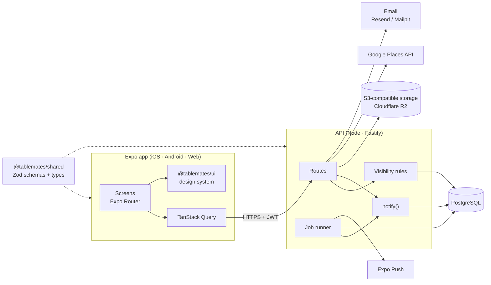

# TableMates

**A social restaurant journal where recommendations come only from people you know.**

TableMates lets you log every restaurant you visit, rate and review it, and see where your friends have been eating. You don't see reviews from strangers. Every rating, photo and recommendation comes from people you've chosen to add, so what you see is the advice of people whose taste you know.

The app runs on iOS, Android and the web from a single TypeScript codebase.

---

## Highlights

| Area | What it offers |
|---|---|
| **Journal** | Log visits with a star rating, a written review, the dishes you ordered, photos and the friends you ate with. Revisits show how your rating changed over time. |
| **Friends-only discovery** | A feed of friends' reviews, plus a filterable map of everywhere you and your friends have been. A For You list ranks places by how closely each friend's taste matches yours. |
| **Planning together** | Dinner plans with voting, shareable lists, food crawls with walking routes, "Ask your friends" requests, and Blend, which finds places a whole group will like. |
| **Groups and presence** | Tables (small friend groups with their own feed, lists and plans), 24-hour "Tonight" stories, a daily plate check, and opt-in "Out now" check-ins. |
| **Motivation** | Weekly streaks, a yearly new-places goal, badges, mayorships among your friends, friend challenges, a year-in-review recap and "On this day" memories. |
| **Notifications** | An activity inbox and push notifications, with a separate mute toggle for each kind of alert. |

See [docs/features.md](docs/features.md) for the full catalog.

## Privacy by design

The friends-only rule is enforced on the server and isn't left to the client.

- **One module decides visibility.** Every query that reads someone else's visits goes through [`apps/api/src/lib/visibility.ts`](apps/api/src/lib/visibility.ts).
- **Each visit has an audience:** friends, close friends or only me.
- **Counts follow the same rules.** Streaks, goals, challenges, mayorships and Blend are built on the same rules, so a private visit never shows up anywhere else.

The test suite checks each rule; see [docs/privacy.md](docs/privacy.md).

## Architecture at a glance



The client and server share one package of request schemas and response types, so a breaking API change fails type checking on both sides. See [docs/architecture.md](docs/architecture.md).

## Technology

| Layer | Stack |
|---|---|
| App | Expo (React Native) with Expo Router, TanStack Query, react-native-maps and the Google Maps JavaScript API |
| API | Node.js 22, Fastify, Drizzle ORM, Zod, JWT access tokens with rotating refresh tokens, Argon2 password hashing |
| Data | PostgreSQL 16, S3-compatible object storage (Cloudflare R2 in production, RustFS locally) |
| Integrations | Google Places API (New), Expo Push, Resend for email |
| Tooling | pnpm workspaces, TypeScript, Vitest, ESLint, Docker Compose |

## Repository layout

| Path | Contents |
|---|---|
| [`apps/mobile`](apps/mobile) | The Expo app for iOS, Android and web |
| [`apps/api`](apps/api) | The HTTP API, database schema and migrations, background jobs and integration tests |
| [`packages/ui`](packages/ui) | The design system: tokens, theming and accessible components ([guide](packages/ui/README.md)) |
| [`packages/shared`](packages/shared) | Zod request schemas and response types used by both apps |
| [`docs`](docs) | Project documentation |

## Getting started

**Prerequisites:** Node.js 22+, Docker, and pnpm. If pnpm isn't installed, prefix each command with `corepack`, which ships with Node (for example `corepack pnpm install`).

```sh
pnpm install
cp .env.example apps/api/.env   # set JWT_SECRET; GOOGLE_PLACES_API_KEY enables restaurant search
pnpm db:up                      # Postgres, a local email inbox (Mailpit) and local photo storage (RustFS)
pnpm db:migrate
pnpm dev:api                    # http://localhost:4000
pnpm dev:mobile                 # press w for web, i for the iOS simulator
```

Sign-up sends a verification code. In development it arrives in Mailpit at http://localhost:8025. Full setup, environment variables and troubleshooting are in [docs/development.md](docs/development.md).

## Quality

```sh
pnpm typecheck   # every package
pnpm test        # API integration tests against Postgres, plus the design-token contrast check
```

- **API tests:** integration tests run against a real Postgres database. They cover privacy for every feature, authorization, and background jobs run with a fixed clock.
- **Accessibility:** a test checks every color pair in the design system against WCAG AA. Components ship with screen-reader labels and visible keyboard focus.

## Documentation

| Guide | For |
|---|---|
| [Features](docs/features.md) | What the product does, feature by feature |
| [Architecture](docs/architecture.md) | How the system is put together, and why |
| [Privacy model](docs/privacy.md) | Who can see what, and how that's enforced and tested |
| [API reference](docs/api.md) | Endpoints, authentication, errors and pagination |
| [Development](docs/development.md) | Local setup, configuration, testing and conventions |
| [Deployment](docs/deployment.md) | Running TableMates in production |
| [Contributing](docs/contributing.md) | Branching, pull requests and the checks every change must pass |
| [Design system](packages/ui/README.md) | Tokens, components and accessibility rules |

## License

[MIT](LICENSE) © 2026 Dylan Ramdath
