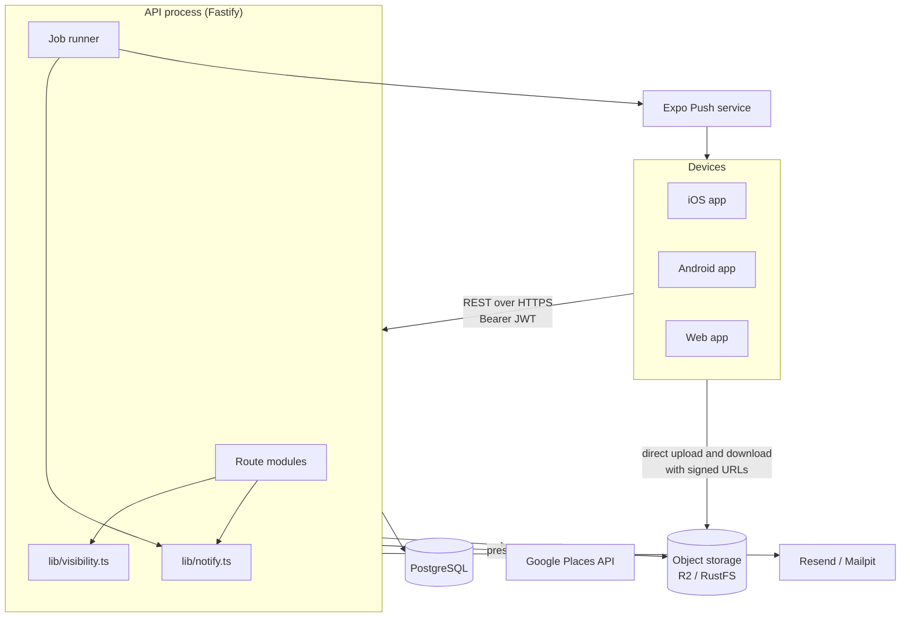
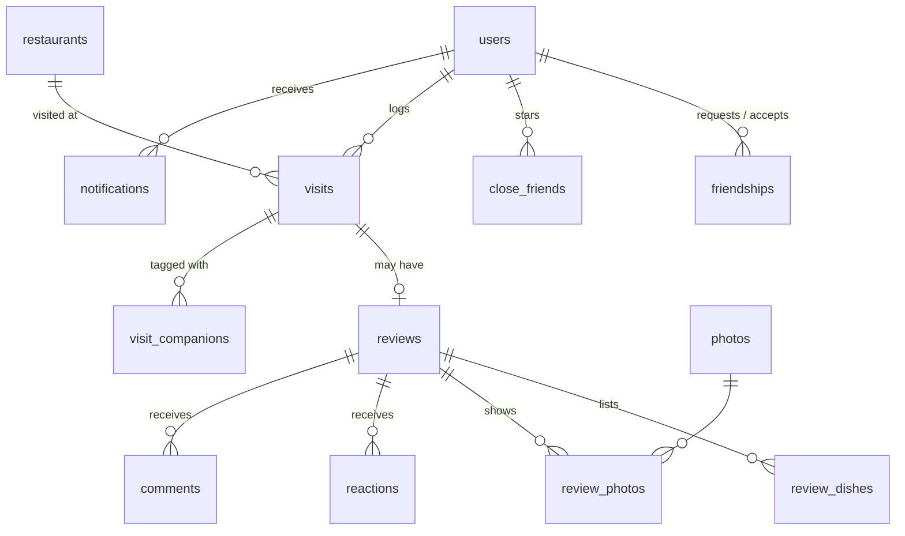
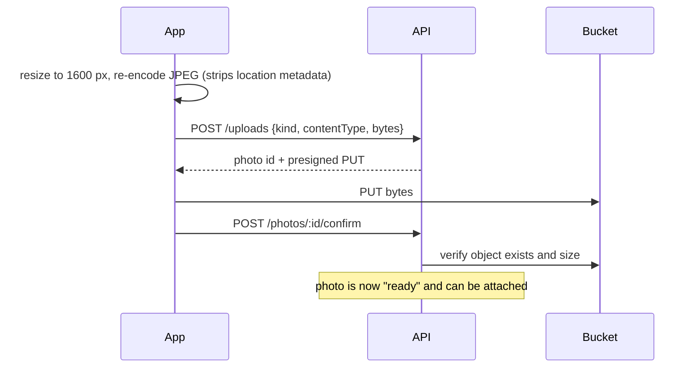

# Architecture

TableMates is a TypeScript monorepo with two applications and two shared packages. This guide explains how the pieces fit together, the design choices behind them, and where to find each concern in the code.

## Contents

- [System overview](#system-overview)
- [Monorepo structure](#monorepo-structure)
- [The API](#the-api)
- [Data model](#data-model)
- [Notifications](#notifications)
- [Background jobs](#background-jobs)
- [Photos and storage](#photos-and-storage)
- [Time zones](#time-zones)
- [The app](#the-app)
- [Key design decisions](#key-design-decisions)

---

## System overview



A single API process serves HTTP requests and also runs the background jobs. Clients never talk to Postgres or to third-party APIs directly. The one exception is object storage: clients upload and download photos straight from the bucket, using short-lived URLs signed by the API.

## Monorepo structure

```
apps/
  api/        Fastify API, Drizzle schema and migrations, jobs, integration tests
  mobile/     Expo app (Expo Router file-based screens)
packages/
  shared/     Zod request schemas + response types (imported by both apps)
  ui/         Design system: tokens, theme provider, accessible components
docs/         This documentation
```

Workspaces are managed with pnpm. `@tablemates/shared` is the contract between client and server:
- The API parses every request body and query with its Zod schemas, and annotates every handler's return type with its response types.
- The app imports the same types for its API client.

A breaking change to the contract therefore fails `pnpm typecheck` in both places.

## The API

### Composition

[`apps/api/src/app.ts`](../apps/api/src/app.ts) builds the Fastify instance from a `Deps` object. The dependencies are:
- The database handle.
- Token and verification services.
- A `PlacesProvider`.
- A `Storage` implementation.
- Configuration values.

Each external service sits behind a small interface, with a production implementation and a fake for tests:

| Concern | Interface | Production | Tests |
|---|---|---|---|
| Restaurant data | `PlacesProvider` | `GooglePlacesProvider` | `FakePlaces` |
| Email | `Mailer` | `ResendMailer`, `MailpitMailer` | `FakeMailer` |
| Photos | `Storage` | `S3Storage` (R2, RustFS, any S3 API) | `FakeStorage` |
| Push | `PushProvider` | `ExpoPushProvider` | `FakePush` |

[`server.ts`](../apps/api/src/server.ts) wires the real implementations, starts the job runner and listens on a port. Tests call the same `buildApp` with fakes and make requests through `app.inject`, so no network is involved.

### Request pipeline

1. **CORS and cookies.** Browser origins are allow-listed with `CORS_ORIGINS`. On the web, the refresh token travels in an httpOnly cookie.
2. **Authentication.** Every route except auth, health and the public avatar redirect sits inside an authenticated scope. A hook verifies the Bearer JWT and sets `req.userId`.
3. **Email verification gate.** Until an account confirms its email, the API answers `403 email_unverified` for everything except `GET /me` and the verify and resend endpoints.
4. **Validation.** Handlers call `parse(schema, input)`. A Zod failure becomes a `400 validation_error` that lists each issue.
5. **Authorization and visibility.** Handlers load data through helpers such as `memberPlan`, `visibleList`, `memberTable` or `visibleVisitFilter`. These return 404 instead of 403 whenever revealing that something exists would leak information.
6. **Errors.** A single error handler turns `AppError`, Zod errors and unique-constraint violations into the [standard error shape](api.md#errors).

### Module layout

| Directory | Responsibility |
|---|---|
| `routes/` | One module per area (feed, visits, lists, plans, tables, challenges, …), each registering its endpoints |
| `lib/visibility.ts` | **The** source of truth for who can see whose visits ([privacy model](privacy.md)) |
| `lib/notify.ts` | The single writer of notifications |
| `lib/` (others) | Domain logic shared across routes: taste matching and Blend, streaks, goals, mayors, challenges, badges, photos, time zones and geography |
| `jobs/runner.ts` | Interval-based job runner |
| `push/` | Push outbox worker and Expo provider |
| `db/` | Drizzle schema, client and migration runner |

## Data model

The schema lives in [`apps/api/src/db/schema.ts`](../apps/api/src/db/schema.ts), and migrations are generated into `apps/api/drizzle/`. The core of the model:



Each feature builds on that core with its own tables:

| Feature | Tables |
|---|---|
| Lists and crawls | `lists` (`kind`: list or crawl; optional `table_id`), `list_items` (`position`), `list_follows` |
| Plans | `plans` (optional `table_id`), `plan_members`, `plan_options`, `plan_votes` |
| Tables | `tables`, `table_members` |
| Stories | `stories`, `story_views` |
| Plate check | `plate_prompts`, `plate_posts` |
| Out now | `checkins` |
| Goals and challenges | `goals`, `challenges`, `challenge_members` |
| Badges | `user_badges` |
| Asks | `asks`, `ask_replies` |
| Other | `saved_places`, `favorites`, `push_tokens`, `refresh_tokens`, `email_verification_codes` |

Some values are **computed on read** instead of stored, so they can't drift from the data they describe: streaks, goal progress, mayorships, taste matches, Blend picks and challenge counts. Each comes from the visits that the asking user is allowed to see.

## Notifications

```mermaid
sequenceDiagram
  participant R as Route / job
  participant DB as Postgres
  participant W as Push worker
  participant E as Expo Push
  R->>DB: BEGIN; change data; notify() inserts row; COMMIT
  loop every 2 s
    W->>DB: select unpushed notifications (< 1 h old)
    W->>DB: claim batch (set pushed_at)
    W->>E: send to device tokens, honoring per-type mutes
  end
```

- **One writer.** `notify(tx, …)` is the only code that inserts notifications. It runs inside the transaction that caused the alert, so a rolled-back change never notifies anyone.
- **Outbox delivery.** The push worker sends only committed rows. It claims a batch before sending, so two workers never send the same alert twice. Alerts more than an hour old are skipped instead of arriving late.
- **No self-alerts.** People never notify themselves. The exceptions are system alerts about their own account: badges, plate prompts, streak reminders, goals and challenge results.

## Background jobs

[`jobs/runner.ts`](../apps/api/src/jobs/runner.ts) runs each job on its own interval, never runs two copies of the same job at once, and logs a failure without stopping the other jobs. Every job is **idempotent** and safe to run on several instances, because it claims its work atomically before acting:
- **`push`, `plate-prompts`, `streak-nudges` and `challenges`** claim each item with a conditional `UPDATE ... RETURNING` (setting `pushed_at`, `notified_at`, `streak_nudged_week`, `completed_at` or `ended_at`). Only one instance's update succeeds.
- **`story-expiry` and `photo-cleanup`** claim rows with `DELETE ... RETURNING storage_key`, then delete the storage objects. A crash between the two steps leaves at most an orphaned object, which a bucket lifecycle rule removes, and never a row pointing at a missing object.

| Job | Interval | Purpose |
|---|---|---|
| `push` | 2 s | Deliver committed notifications as push |
| `plate-prompts` | 30 s | Schedule each time zone's daily plate check and announce it when it's due |
| `story-expiry` | 5 min | Delete expired stories and their photos |
| `challenges` | 5 min | Mark completed members; announce results and award badges after the last day |
| `streak-nudges` | 10 min | Sunday-evening reminder for streaks at risk, once per week |
| `photo-cleanup` | 1 h | Remove uploads that were never confirmed |

Job functions take a `now` argument, so tests can run them against a fixed clock.

## Photos and storage



- The bucket is **private**. A photo URL is a signed GET that expires after an hour, and the API mints one only while building a response the viewer is allowed to see. A photo therefore has exactly the same visibility as the review, story or plate it belongs to.
- Avatars are the one exception: they're served through a public `/avatars/:id` redirect, so they can be embedded anywhere.
- At startup the API creates the bucket and its browser-upload CORS rule if they're missing.

## Time zones

Each device reports its IANA time zone, which is stored in `users.timezone`. Anything with a daily or weekly rhythm is computed in the person's local time using the built-in `Intl` API ([`lib/zoned.ts`](../apps/api/src/lib/zoned.ts)), with no date library:
- The random daily plate-check moment.
- Streak weeks (Monday to Sunday).
- The Sunday 17:00 reminder.
- "This year" for goals.
- "Today" for memories.

## The app

- **Navigation.** Expo Router file-based routes live in `apps/mobile/src/app`. Five tabs (Feed, Map, Log, Friends, Profile) and the stack screens (restaurant, user, plan, list, table, challenge, blend, year in review) are guarded by the auth state: signed out, unverified, onboarding or signed in.
- **Data.** TanStack Query owns server state. Query keys are centralized in `lib/query-keys.ts`, so mutations invalidate exactly the caches they affect. `lib/api.ts` is the typed client.
- **Platforms.** One codebase targets iOS, Android and web. Where platforms differ, platform-specific files handle it (for example `table-map.tsx` uses react-native-maps, and `table-map.web.tsx` uses the Google Maps JavaScript API).
- **Design system.** Screens are built only from `@tablemates/ui` tokens and components ([guide](../packages/ui/README.md)). The app ships in the light theme. Dark tokens exist and pass the contrast check, ready for a future setting.
- **Secrets stay on the server.** The app calls `/places/search` on the API and never Google Places directly. The only key in the client is a browser-restricted Maps key used to draw the map on web.

## Key design decisions

| Decision | Why |
|---|---|
| **Visibility in one module** | Privacy is the product's core promise. Putting every rule in one place makes it auditable, and lets tests mutate a single filter to prove it's enforced. |
| **404 instead of 403 for hidden resources** | It doesn't reveal that a private plan, table, list or challenge exists. |
| **Shared Zod schemas** | The client and server can't drift apart, and validation messages are written once. |
| **Computed, not cached, aggregates** | Streaks, mayors and goals depend on who's asking. Computing them per viewer from visible visits is simpler than invalidating a cache, and can never leak. |
| **Outbox for push** | Alerts are sent only for changes that committed, and survive restarts. |
| **Interfaces around every vendor** | Tests run fully offline, and providers can be swapped: RustFS in development and R2 in production use the same storage code. |
| **Server-side rate limiting on auth** | Sign-up, login and verification are limited per IP to slow down credential stuffing and guessing of email codes. With `REDIS_URL`, the counters are shared across instances. `TRUST_PROXY` makes sure the limit applies to the real client behind a load balancer. |
