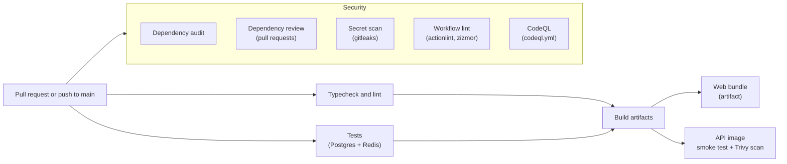

# Continuous integration

Every pull request and every push to `main` runs the pipeline in [`.github/workflows/ci.yml`](../.github/workflows/ci.yml). A pull request is ready to merge only when every job passes. This guide describes each job and how the pipeline is meant to grow into continuous deployment.

## Pipeline



| Job | What it does | Fails when |
|---|---|---|
| Typecheck and lint | `pnpm typecheck` in every package, and `expo lint` for the app | Any type error or lint error |
| Tests | API integration tests against Postgres 16, with Redis for the shared rate-limit test, then the design-token contrast check | Any test fails, or any color pair drops below WCAG AA |
| Dependency audit | `pnpm audit` across the whole lockfile | Any advisory not listed, with a justification, under `auditConfig` in [`pnpm-workspace.yaml`](../pnpm-workspace.yaml) |
| Dependency review | Compares a pull request's dependency changes with the GitHub Advisory Database | The pull request adds a dependency with a high or critical advisory |
| Secret scan | gitleaks over the full git history | Anything that looks like a credential is committed |
| Workflow lint | actionlint (syntax and shell scripts) and zizmor (Actions security: injection, permissions, credential persistence) | Any workflow finding |
| CodeQL | Static security analysis of the TypeScript code ([`codeql.yml`](../.github/workflows/codeql.yml)), also weekly | Results appear on the Security tab and on pull requests |
| Build artifacts | Exports the web app, builds the API container image, starts it and checks `/health`, then scans it with Trivy | The bundle or image fails to build, the image doesn't start, or Trivy finds a fixable high or critical vulnerability or a secret in the image |

## Supply-chain hardening

- **Actions pinned by commit SHA**, with the version in a comment. A tag can be moved; a SHA can't.
- **Scanner images pinned by digest:** gitleaks, Trivy, actionlint and zizmor run from their official images instead of marketplace actions.
- **The same applies to service containers and the API's base image.**
- **Least privilege:** the workflows default to `contents: read`. Only CodeQL gets `security-events: write`, and checkouts don't keep credentials (`persist-credentials: false`).
- **Dependabot** proposes weekly updates for npm packages, GitHub Actions, the Compose services and the API's base image ([`.github/dependabot.yml`](../.github/dependabot.yml)). Security updates open as soon as an advisory is published.
- **Repository settings:** secret scanning with push protection, Dependabot alerts and private vulnerability reporting are enabled.

## Running the checks locally

```sh
pnpm typecheck
pnpm test                                       # needs pnpm db:up
pnpm --filter @tablemates/mobile exec expo lint
pnpm audit --audit-level low
docker build -f apps/api/Dockerfile -t tablemates-api .
```

## Reviewing an advisory

When the dependency audit fails:
1. Upgrade the affected package if a fix exists. That's the preferred outcome.
2. If no fix exists and the code path can't be reached in production, add its GHSA ID to `auditConfig.ignoreGhsas` in `pnpm-workspace.yaml`. Include a comment saying why it's safe and a date to look again.
3. Remove the exception as soon as a fix is released.

## Extending to continuous deployment

The CI workflow is reusable (`workflow_call`), so a deployment workflow can run the same checks first and deploy only what they built. A `cd.yml` would:

1. **Trigger** on pushes to `main` (staging) and on version tags or a manual dispatch (production).
2. **Call CI:** `jobs.ci.uses: ./.github/workflows/ci.yml`, so nothing deploys unless every check passes.
3. **Publish the API image** to GitHub Container Registry, tagged with the commit SHA. This needs `packages: write` for that job only. Optionally sign the image and attach provenance.
4. **Migrate the database:** run `node --import tsx src/db/migrate.ts` from the new image against the target database, before the new version takes traffic.
5. **Deploy:**
   - Roll the API out to the hosting platform by image digest.
   - Upload the web bundle, built with the production `EXPO_PUBLIC_*` values, to the static host.
   - Trigger EAS Build and Submit for the native apps.
6. **Verify:** check `/health` on the new release, and roll back to the previous image digest if it fails.

**Environments:**
- Use GitHub **environments** (`staging`, `production`) to hold each target's secrets (`DATABASE_URL`, `JWT_SECRET`, `RESEND_API_KEY`, `S3_*`, `REDIS_URL`, `TRUST_PROXY`).
- Require a reviewer to approve production deployments.
- The API's startup guard refuses to run in production with any development default, so a misconfigured environment fails fast instead of serving traffic.

## Protecting main

Once CI is on `main`, make these jobs required status checks in a branch protection rule (or ruleset), and block force-pushes and deletion:
- Typecheck and lint
- Tests
- Dependency audit
- Dependency review
- Secret scan
- Workflow lint
- Build artifacts
- CodeQL
